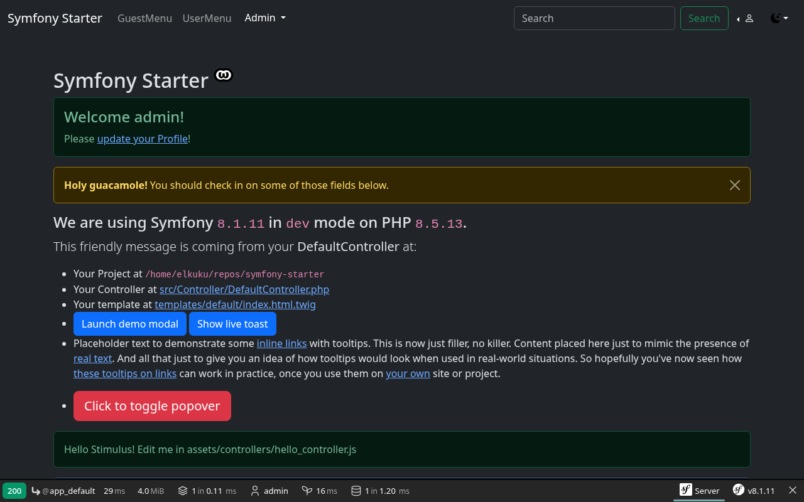

# Symfony Starter




## What's this??
An opinionated [Symfony](https://symfony.com) starter template with user management and social OAuth login, including:

* Symfony 8.*
* Docker compose file for PostgreSQL
* `dev` login form <br/> `prod` Social login with Google, GitLab, GitHub and [more](https://github.com/knpuniversity/oauth2-client-bundle#step-1-download-the-client-library)
* A user CRUD interface
* Bootstrap

## Installation
Create your own repository with GitHub's [Use this template](https://github.com/elkuku/symfony-starter/generate) button, or clone this one:
```shell
git clone https://github.com/elkuku/symfony-starter.git my-project
cd my-project
```
Then run
```shell
bin/install
```
OR execute the script content manually.

It needs Composer, the [Symfony CLI](https://symfony.com/download) and Docker with Compose v2 (`docker compose`).
On a fresh database it loads two users, `user` and `admin`, that you can log in with using the `dev` login form.
   
## Usage
Create and administer user accounts.
```shell
symfony console user-admin
```
Start and stop the environment.
```shell
bin/start
```
```shell
bin/stop
```


## Testing

```shell
make tests
```

## Check for updates
Check for outdated PHP deps, recipes and assets.

```shell
composer check
```

## Database


You can create this with 

```shell
composer db-diagram
```

## Google login

The template ships two Google logins, "Continue with Google" (OAuth redirect) and "Sign in with Google" (Google's own button). Keep the one you need: see [Google login: pick one](doc/google-login.md).

----

Happy coding `=;)`
